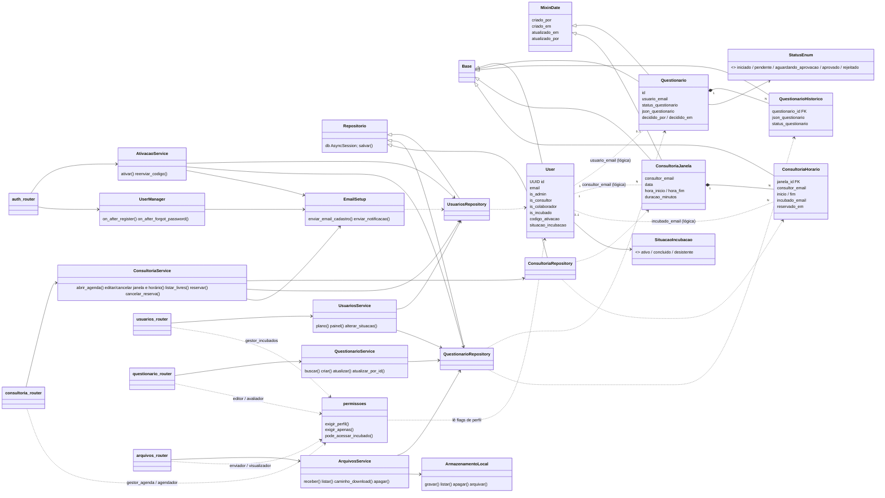

# Diagrama de classes macro — Incubatorium

## Notas de leitura
- Relações pontilhadas `..` entre `User` e demais entidades são **lógicas por e-mail, sem FK**.
- "Sessão" e "Calendário" não existem como módulos de domínio: sessão = `AsyncSession`/JWT; calendário = módulo `consultoria` + `shared/datas.py`.
- Fora do diagrama (transversais): `shared/exceptions` (`NegocioError` e subclasses), `shared/handlers`, `infra/config|db`, `auth/backend`.
- Atribuição de `is_admin/is_consultor/is_colaborador` não tem rota; não verificado se é via script/banco.
